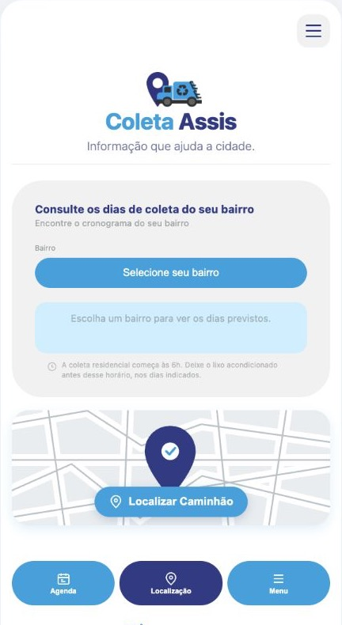
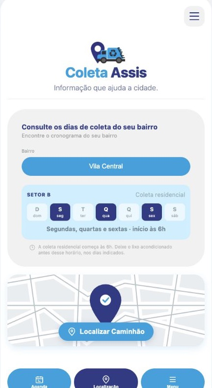
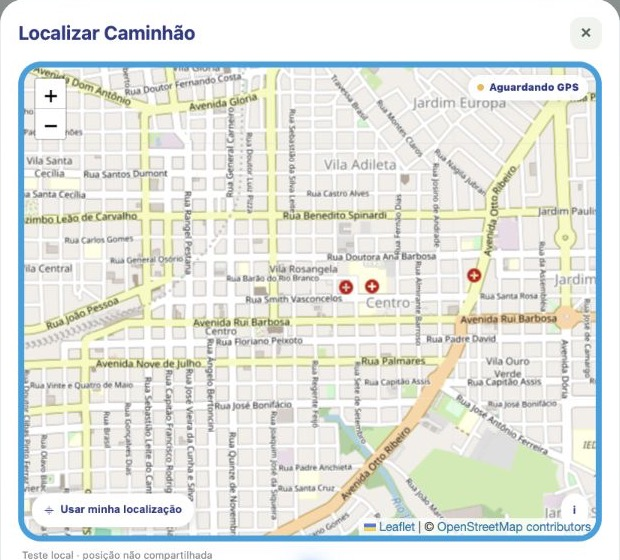

# Coleta Assis

Protótipo web para consultar o cronograma da coleta de resíduos em Assis e visualizar uma prévia da localização do caminhão.

## Prévia do aplicativo

| Tela inicial | Consulta de bairro | Mapa de localização |
| --- | --- | --- |
|  |  |  |

Os dias exibidos na consulta são dados de exemplo do protótipo. A localização mostrada no mapa não representa um caminhão em tempo real.

## Estrutura

- `index.html` — estrutura da página
- `css/styles.css` — estilos e layout
- `js/app.js` — interação, cronograma e mapa
- `assets/` — imagens e ilustrações do projeto
- `screenshots/` — capturas das telas do protótipo

## Executar localmente

O mapa e o acesso à localização funcionam melhor em `localhost` ou em um site com HTTPS. Na pasta do projeto, execute:

```sh
python3 -m http.server 8765
```

Depois abra <http://localhost:8765> no navegador.

O mapa interativo usa Leaflet e tiles do OpenStreetMap. A atribuição aos colaboradores do OpenStreetMap aparece no mapa e no rodapé. O rastreamento no protótipo usa apenas a localização permitida pelo navegador e não envia posições para um servidor.

## Observação

Este projeto é um protótipo estático. O acompanhamento real do caminhão depende de um celular/dispositivo no veículo, conexão de dados e um serviço de backend para compartilhar as posições.
